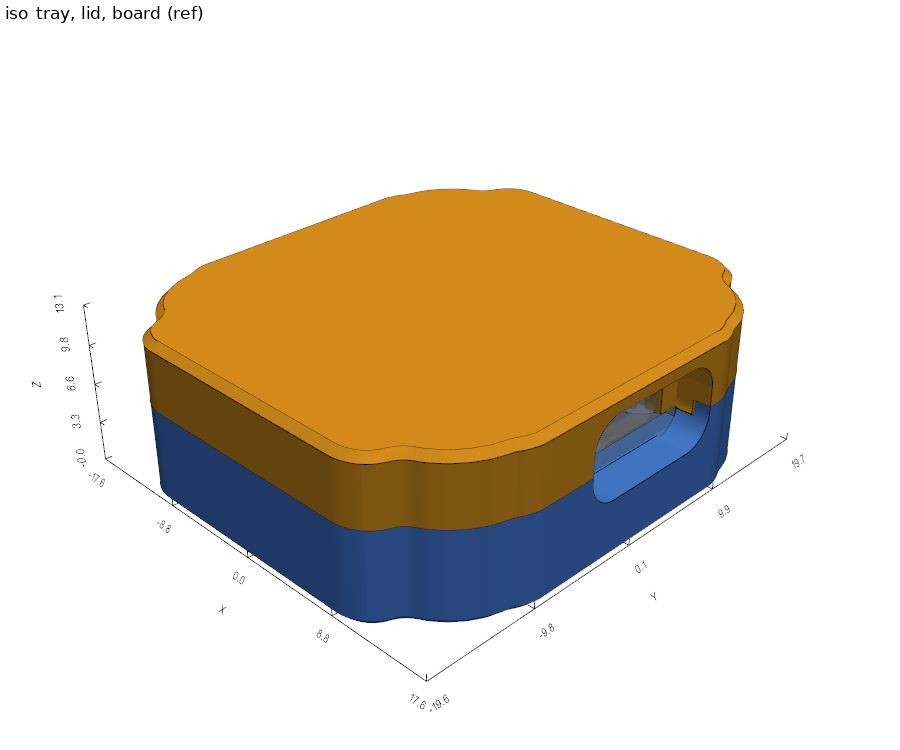
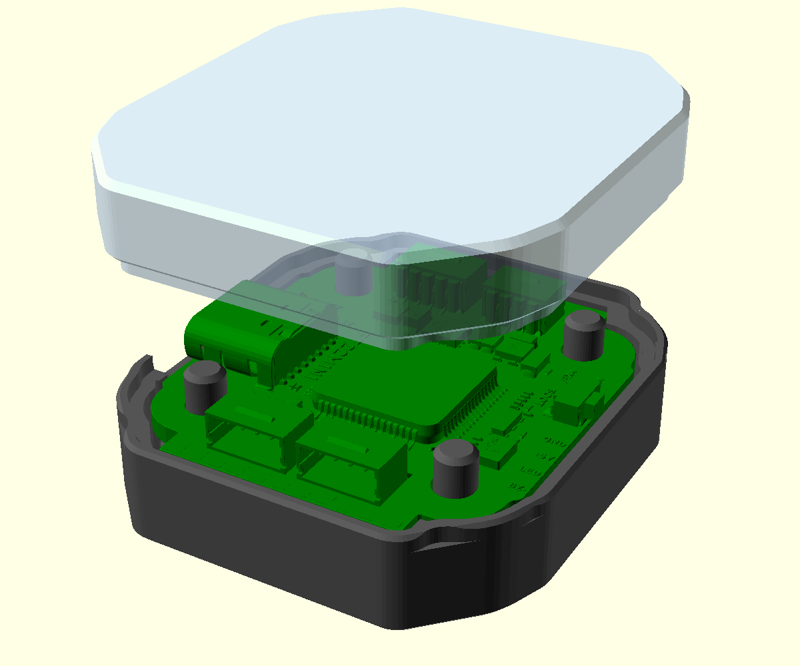
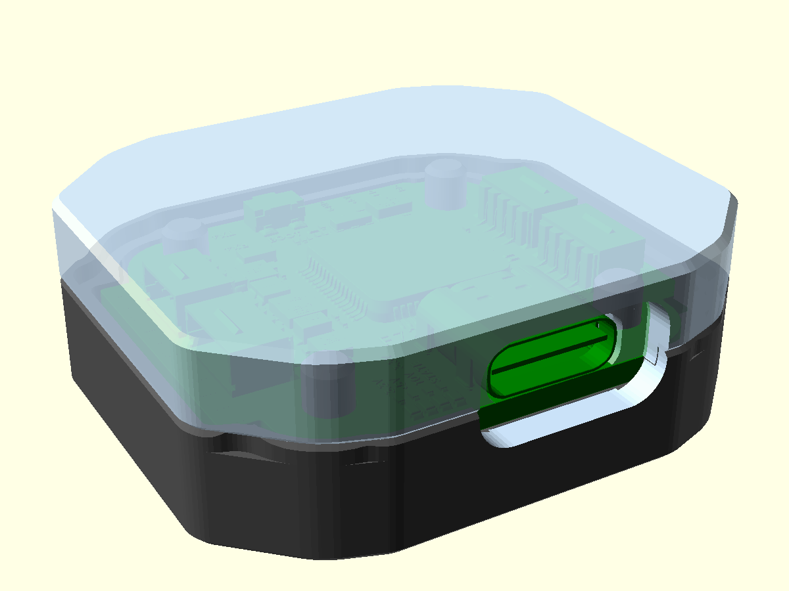

# GokuIMU case

## v3: build123d, for the lab's 0.6 mm nozzles (current)

`gokuimu_case.py` is a build123d port of the v2 OpenSCAD design below, re-proportioned for 0.6 mm nozzles, 0.62 mm lines and 0.3 mm layers. v2's 0.8 / 0.9 mm lips and 0.7 mm crush nubs are thinner than two 0.6 mm lines, so on the lab printers they would print as single weak lines or get dropped by the slicer.

| | v2 (0.4 nozzle) | v3 (0.6 nozzle) |
|---|---|---|
| Wall | 1.8 (0.8 lip / 0.1 / 0.9 lip) | 2.68 (1.24 lip / 0.2 / 1.24 lip) |
| Lid retention | press fit: 3.0 pegs into ribbed sockets in 5.0 pins | press fit: 3.0 pegs into plain 3.1 sockets (print ~2.85) in 5.68 pins |
| Ledge behind the USB pocket | 0.8 | 1.39 (leaves a 1.24 wall in front of the pocket) |
| Collar | 0.8 thick | 1.4 thick, notched 0.9 tall over the status LEDs out to the receptacle shell |
| Seam reveal chamfers | 0.3 | none (smaller than one line) |
| Outside | 33.4 × 37.5 × 13.1 | 35.2 × 39.2 × 13.1 |

Files: `GokuIMU_v3_tray.stl` / `GokuIMU_v3_lid.stl` (already in print orientation), `.step` of each in assembly position, `v3_assembly.png`, `v3_section_usb.png`, `v3_section_pegs.png`.

**Lid retention (both versions).** The lid is held shut by a press fit, not by RTV. Each tray post carries a 3.0 mm peg that goes up through the board's mounting hole and 2.8 mm into a socket in the lid pin above it, with 0.4 mm lead-in chamfers on both. In v3 the socket is drawn at 3.1 mm. At 0.6 mm, vertical holes print 0.2–0.3 mm undersize, so it comes out about 2.85 mm and grips the peg about 0.075 mm a side. Tune it with `sock_d`: raise it toward 3.2 if the lid is too hard to press on, lower it toward 3.0 if it doesn't hold. The pins stop 0.05 mm above a 1.6 mm board (the stack-up now assumes 1.6, against 1.5 in Flywoo's model), so the board can't lift. The bottom 1 mm of each pin is relieved inside |y| < 7.45, where it would graze a small top-side part. The USB collar sits 0.1 mm above the board; an RTV dab closes that if you want it sealed.

Checked with the `build123d-cad` skill's `cadcheck.py` (Spectrum-AI-Tools) against Flywoo's own board model (`goku_board.stl`, ignoring its cosmetic 2.87 mm mount-hole rings):
- every part is one valid solid; tray/lid do not overlap
- the board touches the tray only at the posts and the USB ledge, at most 0.11 mm into the model's bottom-side pads. The lid stays at least 0.125 mm clear of the board model
- no wall under 1.24 mm except the deliberate 0.6 mm (2-layer) roof over the LEDs
- overhangs as printed: tray 3.5 mm², lid 3.5 mm² (tessellation slivers at the bed chamfer and collar edges)

```sh
python <Spectrum-AI-Tools>/plugins/spectrum-cad/skills/build123d-cad/scripts/cadcheck.py case/gokuimu_case.py
```

Check on the first print: the ledge now reaches 1.39 mm under the board edge by the USB-C (v2: 0.8), so make sure it doesn't press on bottom-side pads there; and check the seal round the LED notch beside the receptacle (a small gap above the board that the RTV covers).



## v2 (OpenSCAD, 0.4 nozzle)


Two printed parts: a **tray** and a **clear lid**, for the Flywoo Goku F7 Pro Mini V2. It mounts with VHB on the flat floor. The seam is sealed with RTV, and the only opening is for the USB-C cable.

- Outside: **33.4 × 37.5 × 13.0 mm**. The shape follows the board, including the pad tabs.
- Source: `gokuimu_case.scad` (OpenSCAD). The board comes from `goku_board.scad` / `goku_board.stl`, Flywoo's own 3D model of the board, checked against photos (see [board_model.md](board_model.md)).




## Design (same rules as the SpectrumShine-S case)
| Feature | How |
|---|---|
| Seam with no gap | Shiplap: the tray has a 0.8 mm outer lip, the lid a 0.9 mm inner lip 0.1 mm inside it (each at least two 0.4 mm lines). The lid's outer wall lands on the tray lip, so the outside seam closes flat. A 0.3 mm chamfer each side makes a neat reveal line and a groove to tool the RTV into. The only tray/lid overlap is the press fit: 16 ribs × 0.065 mm³ (fitcheck). |
| Lid held shut by a press fit; board held flat | The board sits on four posts under the mount-hole pads. Everything else under it is relieved 0.3 mm, so nothing presses on the bottom-edge solder pads. A 3.0 mm peg on each post goes up through the board hole (open bore 3.3–3.7 mm with the grommets removed) and 2.8 mm into a 5.0 mm pin on the lid. Each pin's socket has four crush ribs that grip the peg 0.075 mm a side, so pushing the lid home presses all four pegs in and the lid stays shut. A 0.4 mm lead-in chamfer is on both peg and socket. The pins stop 0.05 mm above a 1.6 mm board, so the board can't lift. |
| Only USB exposed | A 12.8 × 6.8 mm pocket in the +X wall takes the cable's overmold (USB-C spec max 12.35 × 6.5), full height above and below the USB axis. Its back plane is 0.15 mm outside the board edge and inside the receptacle face, so the overmold always reaches the receptacle. Behind the pocket, a local ledge carries the board edge from below, and a collar on the lid sits on the board top and passes the receptacle shell with 0.15 mm clearance. Either side, dams in the tray and the collar fill the board-edge slot. |
| Clear lid | Print the lid in clear PETG: the four status LEDs (STATE, 10V, 5V, 3V3) light it from inside. The roof is thinned to 0.6 mm over the LEDs (X 11.8–14.3). FDM clear PETG is translucent rather than transparent: expect a glow you can read, not a window. |
| No supports | Tray prints floor down with **0 mm²** of overhang. Lid prints top face down with **1.2 mm²** (collar edges). The top face is the bed face, so it comes out smooth and as clear as PETG gets. |

Heights: the tallest parts are the USB-C shell (3.5 mm above the board) and the JST SH connectors (3.2 mm on top, 3.18 mm underneath). The case leaves 0.5 mm under the bottom ones; the lid height is set by the USB pocket. The board outline has 0.4 mm clearance in X and 0.6 mm in Y, where the photo measurements spread most. The lid ceiling sits 0.3 mm over the USB pocket, which is above the top connectors.

## Print
| Part | Material | Orientation | Supports |
|---|---|---|---|
| Tray | PETG or PETG-GF, any colour | Floor down | None |
| Lid | **Clear PETG** | Top face down (as exported) | None |

0.2 mm layers, 0.4 mm nozzle, 4–5 perimeters (the walls are 1.8 mm). For the clearest lid, use 100% infill on the top-face layers, a slightly slower first layer and a smooth PEI or glass bed.

## Assembly
1. Flash and bench-test the board first. Remove the four rubber grommets.
2. Drop the board into the tray, USB-C toward the pocket, onto the four pegs.
3. Optional, for a sealed case: put a small dab of neutral-cure RTV where the receptacle shell passes through the collar (the collar sits 0.1 mm above the board there), and run a thin bead along the tray lip.
4. Line the lid's pins up over the pegs and press the lid straight down (or squeeze it in a vise with soft jaws) until the seam closes flat. The press fit holds it shut; without RTV the lid can be pried off later.
5. Stick the floor to the robot with VHB (about 30 × 33 mm).

The BOOT button is sealed in. Use `gokuimu.py dfu` or `rebootToBootloader()` to get into DFU mode.

## Checks
- `fitcheck.py` exports the parts in assembled position and checks them against `goku_board.stl` (results in `fitcheck_result.txt`). The case parts are watertight, so the point-in-solid tests are valid even though the board mesh isn't. Tray/lid overlap is 0.000 mm³. The only contacts are the intended ones: the board's bottom face on the posts and the pocket ledge. The lid pins and collar stay 0.05–0.1 mm clear of a 1.6 mm board (0.12 mm on Flywoo's 1.5 mm model). Fitcheck only tests clearance to modelled parts; it can't see leaks or the unmodelled small parts.
- `printcheck.py` lists every downward face steeper than 45° in print orientation.

## Things to confirm on the first print
- **Board fit.** The outline was measured from photos (±0.3 mm). The case allows 0.4 mm in X and 0.6 mm in Y. If it's tight, raise `gap` / `gap_y`.
- **USB-C plug seating** with your cable. If the overmold is bigger than 12.8 × 6.8, raise `OM_W` / `OM_H`.
- **Lid press fit.** If the lid is too hard to push home, lower `rib_t` (0.075). If it doesn't hold, raise it to 0.1–0.12 or raise `peg_in`. A test print of one post and one pin is quick.
- **LED visibility** through your clear PETG.
