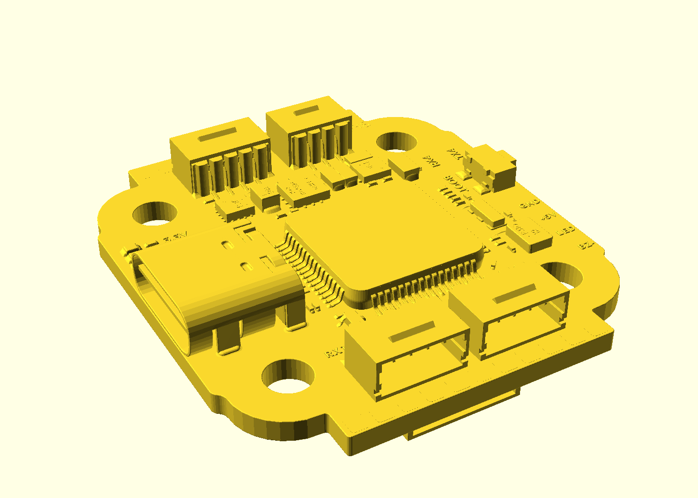

# Goku F7 Pro Mini V2 board model

The case is built around **Flywoo's own 3D model** of the board: the one embedded on the [product page](https://flywoo.net/products/goku-f7-mini-v2-20x20-flight-controller). The downloaded file is `flywoo_model/goku_f722_pro_mini_v2_flywoo.glb`; it is Draco-compressed, so reading it needs `pip install DracoPy`.

- `goku_board.stl` is that model in the case frame: origin at the centre of the four holes, z = 0 on the PCB bottom face, +X toward the USB-C edge, +Z the top side.
- `goku_outline_flywoo.scad` is the PCB outline, sectioned from the model's PCB.
- `goku_board.scad` holds the numbers the case uses.

## Getting it into millimetres
The GLB has no real units. Its PCB is 0.578 × 0.651 × 0.030 units.

- **Scale:** I fitted circles to the four mount holes. They are 0.3983 units apart (0.3976 in X and 0.3990 in Y, 0.35% apart), so 20 mm gives **50.21 mm per unit**.
- **Orientation:** the model has the USB-C on its −Z side, so it is turned 180° about X. That is a rotation, not a mirror image.

What the model gives, and how it compares with the earlier work:

| | Flywoo model | Photo measurement | KiCad rebuild |
|---|---|---|---|
| Board | 29.04 × 32.67 mm | 29.1 × 32.3–32.8 | 29.1 × 32.2 |
| PCB thickness | 1.50 | 1.6–2.0 (perspective) | 1.6 (assumed) |
| Mount holes | 3.55 on 20.0 | ~3.5 | 3.5 |
| USB-C face | x 14.47, flush with the board edge (14.52) | | 14.83 (wrong, as the review said) |
| USB-C centre | y 2.0, 1.69 above the board top | | y 1.5, 1.63 |
| Connectors | JST SH 1.0 mm, about 3.2 tall | | JST GH 1.25, 4.24 tall (**wrong**) |
| Tallest on top | USB-C, 3.5 above the board | | |
| Tallest underneath | SH 6P / 8P, 3.18 | | 4.33 |

**Connector type.** In the rectified photo the pins are 1.0 mm apart, so the connectors are **JST SH** (SM04B / SM06B / SM08B-SRSS-TB, 2.96 mm tall), not GH. The KiCad library SH widths (6.0 / 8.0 / 10.0) match the photo (6.5 / 8.3 / 10.4) and Flywoo's model. My first rebuild used GH, which made the case about 1.2 mm taller than it needed to be.

## Checked against the photos
`board_overlay_top.png` and `board_overlay_bottom.png` draw Flywoo's outline (red) and every part's footprint (cyan) on the top and bottom photos. The photos are rectified onto the board using the holes. Every pad, connector, IC, the USB-C, the LEDs and the BOOT switch land on their photo counterparts, and the outline follows the board edge, including the notches by the pad tabs. Two independent sources agree: the manufacturer's model and the photos measured with datasheet-checked scale (LQFP-64 leads 12.0 mm, TSSOP-28 9.7 mm).

## Earlier work, kept for reference
`kicad/` is the first rebuild: library footprints placed at photo-measured positions (`build_board.py`, `goku.kicad_pcb`, STEP / GLB exports). It got the layout, scale and axis direction right, but used the wrong connector family and put the USB-C face 0.36 mm too far out. It is no longer used by the case.

## Still uncertain
- **PCB thickness.** The model says 1.5 mm; FC boards are often 1.6. The lid's crush nubs take either (0.1–0.2 mm preload).
- **Axis mapping.** The silkscreen arrow by BOOT hasn't been mapped to the IMU axes in this frame. That matters for `MountPose`, not for the case.
